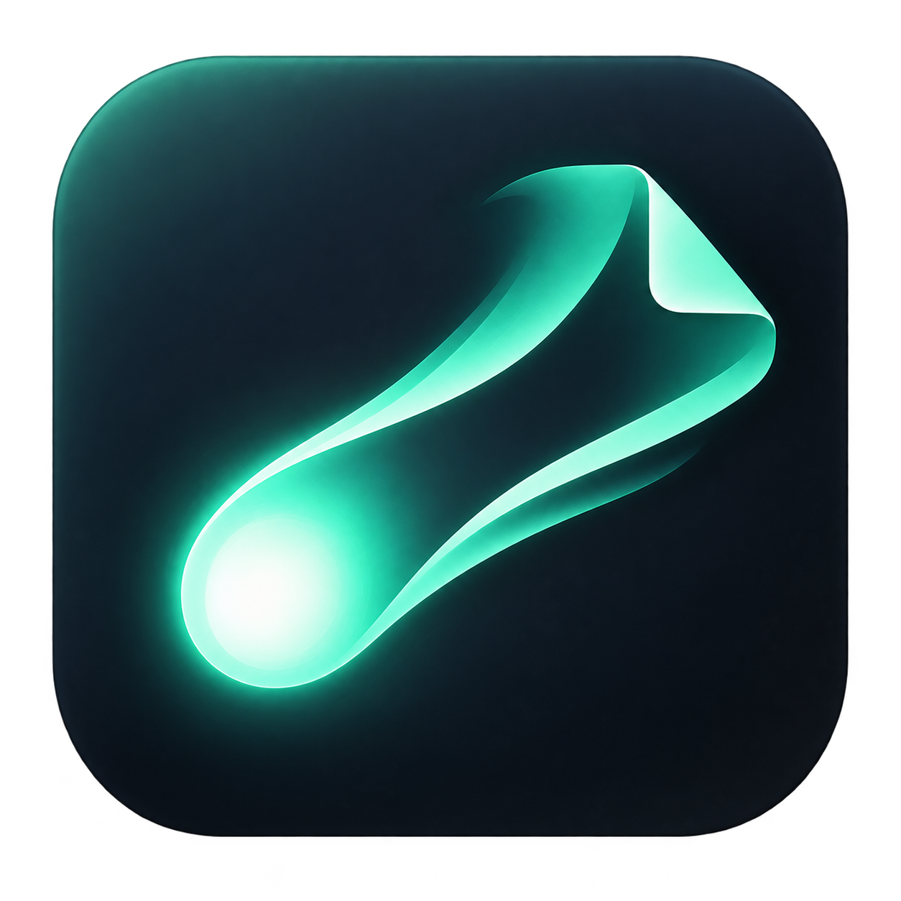

<p align="center">
  
</p>

<h1 align="center">CometForge</h1>

<p align="center">Build. Compress. Split. Compare.<br />A local-first PDF toolkit for your desktop.</p>

<p align="center">
  
  
  
  
</p>

<p align="center">Made by <a href="https://github.com/zxcvresque">Zxcvresque</a> · <a href="https://github.com/zxcvresque/CometForge">GitHub</a></p>

## Features

- Drop PDFs, JPGs, PNGs, TIFFs, ZIPs, or folders anywhere to fill the queue.
- Sort naturally by name or modification date; rearrange individual files or selections.
- Compress with a quality-first size cap and split into a chosen number of complete, page-based PDFs.
- Combine compression with fast web view (linearization).
- Follow a focused Sources → Layout → Export → Review workflow.
- Navigate with a compact Prism-style glass sidebar; detailed controls live in the workspace.
- Rotate all pages, individual source files, or selected PDF page ranges in 90° steps.
- Choose original dimensions, A0–A6, B4/B5, US Letter, Legal, Tabloid, Executive, or 4×6 / 5×7 photo paper.
- Set portrait or landscape orientation, fit content within the page, fill with cropping, or preserve actual size.
- Choose no, small, medium, large, or custom margins. Unused page space is white.
- Choose Prism glass, Comet mint, Light, or System appearance. Themes remember your choice, with visible keyboard focus and reduced-motion/transparency fallbacks.
- Get responsive button feedback and short navigation/menu transitions, shared by Windows and macOS.
- Inspect each output’s filename and actual size, then compare matching pages with a draggable before/after divider.
- Download individual PDFs or all parts as a ZIP. Files are processed on your machine.

## Desktop app

Download the [Windows 1.2.0 installer](https://github.com/zxcvresque/CometForge/releases/download/v1.2.0/CometForge-1.2.0-Windows-x64-Setup.exe) or [macOS 1.2.0 DMG](https://github.com/zxcvresque/CometForge/releases/download/v1.2.0/CometForge-1.2.0-macOS-arm64.dmg) from [GitHub Releases](https://github.com/zxcvresque/CometForge/releases).

On **macOS**, open the DMG, drag CometForge to Applications, and launch it. On **Windows**, run the Setup EXE. Installed editions open in their own app window, not a browser.

The installed edition opens the interface in its own desktop window using the system WebView (WKWebView on macOS, WebView2 on Windows). Processing stays on your machine through a service bound to localhost. Source launches also use the desktop window by default; `--browser` explicitly opens your browser instead.

Windows uses a dedicated `CometForge.exe` with an embedded app icon and taskbar identity. PDF tools run invisibly; no command window is needed. After upgrading from 1.1.0, unpin the old taskbar item and pin the new CometForge shortcut once.

Python and PDF libraries are bundled. Keep **Ghostscript** enabled for Target-fit compression and page preview. Windows setup also includes the Visual C++ runtime and installs WebView2 if missing; that runtime download can need internet access.

The macOS build targets Apple silicon on macOS 14+. The Windows build targets Windows 10/11 x64. Builds are not notarized on macOS or signed on Windows, so platform security prompts may appear.

## Page layout

The Layout step applies to PDFs and images before compression and splitting. Source-file rotations follow their files when you reorder the queue. Use the page-range rotation controls to correct individual pages in the assembled document; page numbers follow the current queue order. Original dimensions preserve mixed-size documents by default.

**Fit** keeps all content visible, **Fill** crops content to fill the printable area, and **Actual size** keeps the original scale and may crop oversized content. Margins and unused space have a white background. The exported layout is also used for before/after comparison so both sides stay aligned.

Changing paper size, orientation, or margins produces print-ready pages and flattens interactive annotations into their visible appearance. Rotation-only exports preserve interactive annotations.

## Run from source

Requires **Python 3.9+**. Run from the project folder to open the desktop app:

```sh
python3 -m venv .venv
.venv/bin/python -m pip install -r requirements.txt
.venv/bin/python launcher.py
```

On Windows:

```powershell
py -m venv .venv
.venv\Scripts\python.exe -m pip install -r requirements.txt
.venv\Scripts\pythonw.exe launcher.py
```

Add `--browser` to open your default browser, or `--no-browser` to run only the localhost service. Keep the launcher running while using browser mode. Closing the desktop window stops its local service.

Install Ghostscript separately for Target-fit and comparison rendering: `brew install ghostscript` on macOS, or use the [Windows installer](https://ghostscript.com/releases/gsdnld.html). For a custom location, set `COMETFORGE_GHOSTSCRIPT` to the executable path. Ghostscript is a native dependency, not a Python package.

## Quality and size

- **Off:** assemble PDFs without compression.
- **Lossless optimize:** reduce structural overhead without degrading images; a size cap is not guaranteed.
- **Target-fit:** seek the highest supported image quality below each output’s cap, checked after linearization. Image recompression can be lossy; text and vectors are preserved where possible. If the cap cannot be met at the supported quality floor, the job reports failure.

The target is a ceiling, not a size to pad files to. Already-small files are not enlarged. Sizes use decimal megabytes: **1 MB = 1,000,000 bytes**.

Quick per-part estimates do not run compression and are approximate. **Forge** reports actual output sizes and per-part progress. Split parts preserve page order and divide pages as evenly as possible; they are not raw file fragments.

**HD comparison** re-renders matching pages as you zoom, up to 576 DPI with large-page safety limits. Both sides use the same resolution; the viewer shows the actual DPI. HD cannot restore detail already lost during compression.

Save needed outputs before restarting the app or browser service; job history is not persistent.

## Verification

Run the PDF and interface checks from the project folder:

```sh
.venv/bin/python scripts/test_page_layout.py
.venv/bin/python scripts/test_options_api.py
.venv/bin/python scripts/test_windows_desktop.py
.venv/bin/python scripts/verify_v1_1.py
.venv/bin/python scripts/test_hd_render.py
node --test scripts/test_guided_ui.cjs scripts/test_comparison_ui.cjs scripts/test_layout_ui.cjs scripts/test_themes_ui.cjs scripts/test_motion_ui.cjs
```

The Windows release workflow also installs the built Setup EXE and checks its native window, PDF export, preview rendering, shutdown, and absence of visible terminal windows.

## Appearance

Use the theme selector in the sidebar to choose Prism glass, Comet mint, Light, or System. The Prism treatment draws on the layered glass and accent system in [Prism Download Manager](https://github.com/FortoGraphy/prism-download-manager), adapted to CometForge’s document workflow. PDF pages and unused export space stay white in every theme.

## Dependencies

Bundled components retain their own licenses. See [third-party notices](packaging/THIRD_PARTY_NOTICES.txt) and [Ghostscript licensing](https://ghostscript.com/licensing/).
